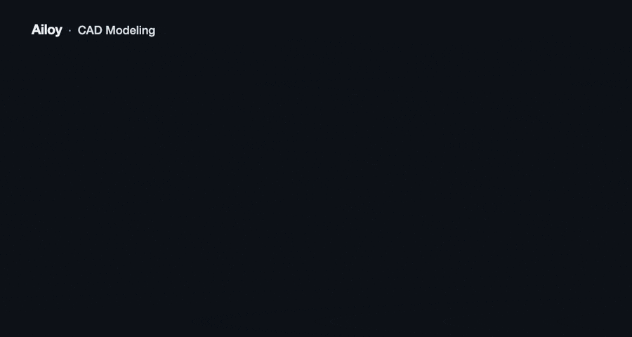
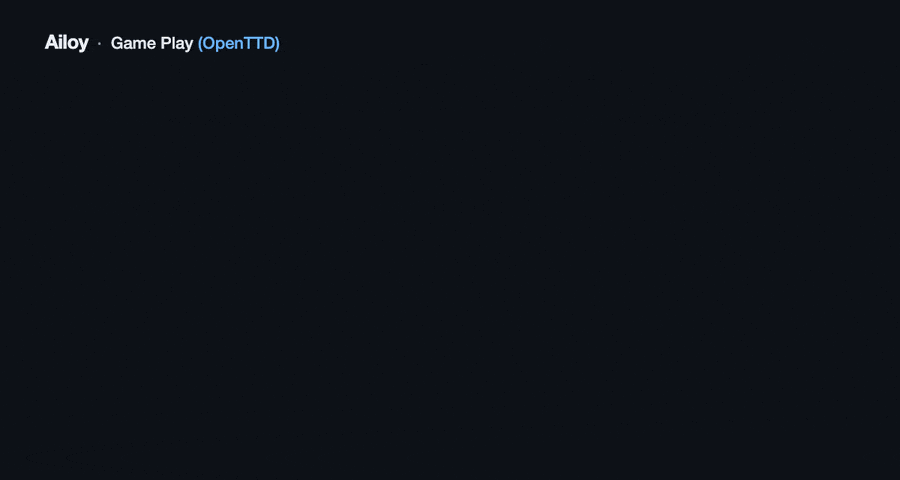
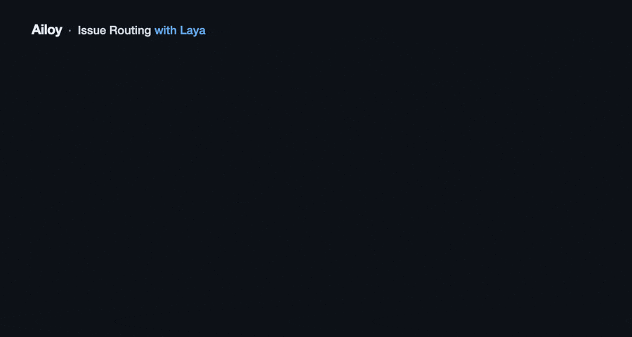

<p align="center">
  <picture>
    <source media="(prefers-color-scheme: dark)" srcset="https://raw.githubusercontent.com/brekkylab/ailoy/main/docs/public/img/ailoy-logo-signature-white.svg">
    
  </picture>
</p>

<h3 align="center">The open-source agent SDK that gives every agent its own VM.</h3>

<p align="center">
   <a href="https://crates.io/crates/ailoy"></a>
   <a href="https://pypi.org/project/ailoy-py/"></a>
   <a href="https://www.npmjs.com/package/@brekkylab/ailoy"></a>
</p>

<p align="center">
  <a href="https://ailoy.co/docs/"></a>
  <!-- <a href="https://docs.rs/ailoy"></a> -->
  <a href="https://discord.gg/27rx3EJy3P"></a>
  <a href="https://x.com/brekkylab"></a>
</p>

<br>

Ailoy is an open-source SDK for building AI agents right in your own code. Every agent gets a Linux VM of its own as its sandbox, so it can install software, write and run code and keep files without touching your machine. The sandbox is part of how you build the agent, not a separate service you wire in.

<table align="center">
  <tr>
    <td align="center"><br><sub>CAD modeling</sub></td>
    <td align="center"><br><sub>Image editing</sub></td>
  </tr>
  <tr>
    <td align="center"><br><sub>Gameplay</sub></td>
    <td align="center"><br><sub>Laya(JEV)</sub></td>
  </tr>
</table>

It supports  Python,  JavaScript ( TypeScript), and  Rust APIs, and works on  Linux,  Windows, and  macOS.

> [!WARNING]
> Ailoy is under active development, and its API may change between versions.

## Requirements

No system dependencies are required, but your agent's model needs a way to run: by default its provider's CLI (Claude Code, Codex or Gemini CLI), or its API with a key.

On Windows, the sandbox's micro-VM runs on the *Windows Hypervisor Platform*, which is off by default.
Turn the optional feature on from an administrator PowerShell and restart, with virtualization enabled in the firmware:

```powershell
Enable-WindowsOptionalFeature -Online -FeatureName HypervisorPlatform
```

## Quickstart

By default, Claude, GPT and Gemini run through their CLIs, so install and log in to the one for your model: [Claude Code](https://docs.anthropic.com/en/docs/claude-code) (`claude`), [Codex](https://github.com/openai/codex) (`codex`) or [Gemini CLI](https://github.com/google-gemini/gemini-cli) (`gemini`).

To call the provider's API instead, set its key and switch the org to the `api` backend before building the agent, e.g. `ailoy.set_lang_model_provider("anthropic", "api")` in Python (`setLangModelProvider` in Node.js, `ailoy::model::set_lang_model_provider` in Rust):

```sh
export ANTHROPIC_API_KEY=...   # or OPENAI_API_KEY, GEMINI_API_KEY
```

Amazon Bedrock, OpenRouter and vLLM are backends too; see the [model providers guide](https://ailoy.co/docs/guides/model-providers/).

Then build your agent with this simple API in your preferred language:

<details>
<summary><b>Python</b></summary>

```sh
pip install ailoy-py
```

```python
import asyncio
from pathlib import Path

from ailoy import AgentBuilder
from virtx import Client


async def main() -> None:
    # Starts virtx's server, fetched into its cache the first time.
    client = Client.spawn()
    async for _ in client.pull_image("python:3.12-slim-trixie"):
        pass
    sandbox = await client.create_sandbox("python:3.12-slim-trixie")

    agent = await (
        # For openai, use "openai/gpt-6-luna"
        AgentBuilder("anthropic/claude-haiku-5-5")
        .instruction("Write what you are asked for into /artifacts.")
        .sandbox(sandbox)
        .build()
    )

    async for output in agent.run("Create a bar chart comparing the populations of European countries and save it to /artifacts/population.png."):
        for part in output["message"]["contents"]:
            if part["type"] == "text":
                print(part["text"])

    Path("population.png").write_bytes(await sandbox.read_file("artifacts/population.png"))

asyncio.run(main())
```

`agent.run` yields one complete message for each step of the tool loop, and `agent.run_stream` streams each message token by token as the model writes it.

</details>

<details>
<summary><b>Node.js</b></summary>

```sh
npm install @brekkylab/ailoy @brekkylab/virtx
```

```js
const { writeFileSync } = require('node:fs')
const { AgentBuilder } = require('@brekkylab/ailoy')
const { Client } = require('@brekkylab/virtx')

async function main() {
  // Starts virtx's server, fetched into its cache the first time.
  const client = Client.spawn()
  for await (const _ of client.pullImage('python:3.12-slim-trixie'));
  const sandbox = await client.createSandbox('python:3.12-slim-trixie')

  // For openai, use "openai/gpt-6-luna"
  const agent = await new AgentBuilder('anthropic/claude-haiku-5-5')
    .instruction('Write what you are asked for into /artifacts.')
    .sandbox(sandbox)
    .build()

  for await (const { message } of agent.run('Create a bar chart comparing the populations of European countries and save it to /artifacts/population.png.')) {
    for (const part of message.contents) {
      if (part.type === 'text') console.log(part.text)
    }
  }

  writeFileSync('population.png', await sandbox.readFile('artifacts/population.png'))
  await agent.close()
  await client.close()
}

main()
```

`agent.run` yields one complete message for each step of the tool loop, and `agent.runStream` streams each message token by token as the model writes it.

</details>

<details>
<summary><b>Rust</b></summary>

```toml
[dependencies]
ailoy = "0.3"
virtx = { package = "virtx-rs", version = "0.1" }
```

```rust
use ailoy::{
    agent::AgentBuilder,
    message::{Message, Part, Role},
};
use futures::StreamExt as _;
use virtx::{Client, Files as _, SandboxCreateArgs};

#[tokio::main]
async fn main() -> anyhow::Result<()> {
    // Starts virtx's server, fetched into its cache the first time.
    let client = Client::spawn_virtx([] as [&str; 0])?;
    let mut pull = client.pull_image("python:3.12-slim-trixie", None).log();
    while let Some(entry) = pull.next().await {
        entry?;
    }
    let sandbox = client
        .create_sandbox(&SandboxCreateArgs::new("python:3.12-slim-trixie"))
        .await?;

    // For openai, use "openai/gpt-6-luna"
    let mut agent = AgentBuilder::new("anthropic/claude-haiku-5-5")
        .instruction("Write what you are asked for into /artifacts.")
        .sandbox(sandbox.clone())
        .build()
        .await?;

    let query = Message::new(Role::User).with_contents([Part::text("Create a bar chart comparing the populations of European countries and save it to /artifacts/population.png.")]);
    let mut stream = agent.run(query);
    while let Some(output) = stream.next().await {
        let message = output?.message;
        if message.role == Role::Assistant {
            for text in message.contents.iter().filter_map(Part::as_text) {
                println!("{text}");
            }
        }
    }

    let png = sandbox.read_file("artifacts/population.png", 0, None).await?;
    std::fs::write("population.png", png)?;
    Ok(())
}
```

`agent.run` yields one complete message for each step of the tool loop, and `agent.run_stream` streams each message token by token as the model writes it.

</details>


...Or skip the reading: point your coding agent (Claude Code, Codex, Cursor, ...) at this README and tell it what agent you want to build. This repo is its own plugin marketplace, so the [agent skill](skills/ailoy/SKILL.md) installs with no clone first:

```bash
claude plugin marketplace add brekkylab/ailoy && claude plugin install ailoy@brekkylab
codex plugin marketplace add brekkylab/ailoy && codex plugin add ailoy@brekkylab
```

## What can an agent do?

> You'll need a GPU (any GPU that supports Vulkan, or Metal on Macs) for the examples that run ML models.

| Example | Description |
| --- | --- |
| [hello](./examples/hello) | One turn with no tools and no sandbox |
| [cad](./examples/cad) | Writes CadQuery, renders the model from four sides, looks at the renders and iterates |
| [offshore_leaks](./examples/offshore_leaks) | Analyses the ICIJ Offshore Leaks database with SQL and Python that the agent writes itself |
| [retail_bench](./examples/retail_bench) | Runs a supermarket simulator, one day per turn |
| [gameplay](./examples/gameplay) | Plays OpenTTD (Transport Tycoon Deluxe) while you watch over VNC |
| [sam3](./examples/sam3) | Segments images and videos with SAM3 on the guest GPU (ncnn + Vulkan) |
| [tts](./examples/tts) | Speaks text in a voice described in words, using Qwen3-TTS |
| [laya](./examples/laya) | Answers typed decision questions with a local model on the GPU |
| [browser-use](./examples/browser-use) | Waits for what you ask of it, in a window of your own browser |

Each example lives in `examples/<name>`, with one folder per language (`rust`, `python`, `node`) and, where the three share files (skills, prompts, model preparation scripts), a `shared` folder.

Rust:

```sh
cargo run --example <name>
```

Python:

```sh
cd examples/<name>/python
uv run main.py
```

Node:

```sh
cd examples/<name>/node
npm install
npm start
```

## How it works

Ailoy gives the agent **a computer of its own**.

Agent stacks are often put together from separate pieces: a library that runs the loop around the model, a hosted service that provides the sandbox, and glue code between the two. Ailoy keeps the loop and the sandbox in one SDK:

- The **Ailoy SDK** runs the agent loop on your host. It sends the prompt to the model, runs the tool calls the model asks for, feeds the results back, and decides when the agent is done.
- **[virtx](https://github.com/brekkylab/virtx)** gives each agent a Linux VM of its own, built on krun, with no separate VM daemon to install. The VM is the agent's sandbox: its commands and file tools run inside it, and files go in and out of it through virtx, never through your machine's own folders.

That lets you build agents that do more than call predefined tools. Inside its VM an agent can install and use software, write its own scripts and work in a general-purpose computing environment. The VM supports the GPU too, so an agent can run ML models, or even games, in there.

The [docs](https://ailoy.co/docs/) cover the VM's image, volumes and resources, and the [virtx](https://github.com/brekkylab/virtx) README covers the VM layer itself.

## Building from source

```sh
git clone https://github.com/brekkylab/ailoy
cd ailoy
cargo build
```

For the bindings:

```sh
cd bindings/python && uv run maturin develop  # Python
cd bindings/node && npm install && npm run build  # Node.js
```

## Contributing

Bug reports, ideas and pull requests are welcome. [CONTRIBUTING.md](./CONTRIBUTING.md) covers setup, tests and how to open a PR. Questions and show-and-tell go on [Discord](https://discord.gg/27rx3EJy3P).

## License

Apache-2.0. See [LICENSE.md](./LICENSE.md).
